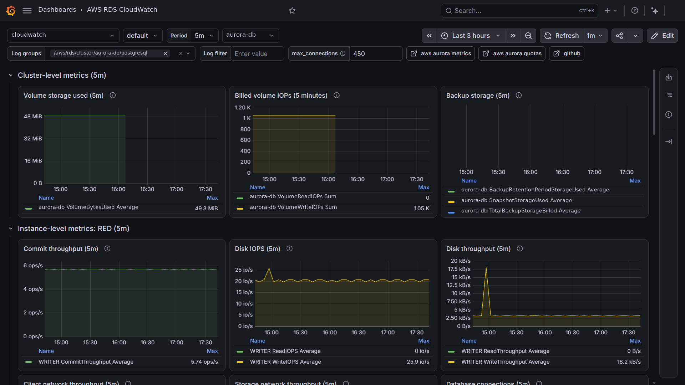
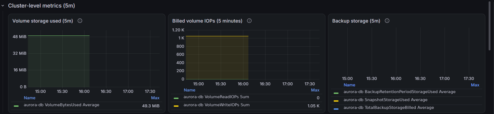
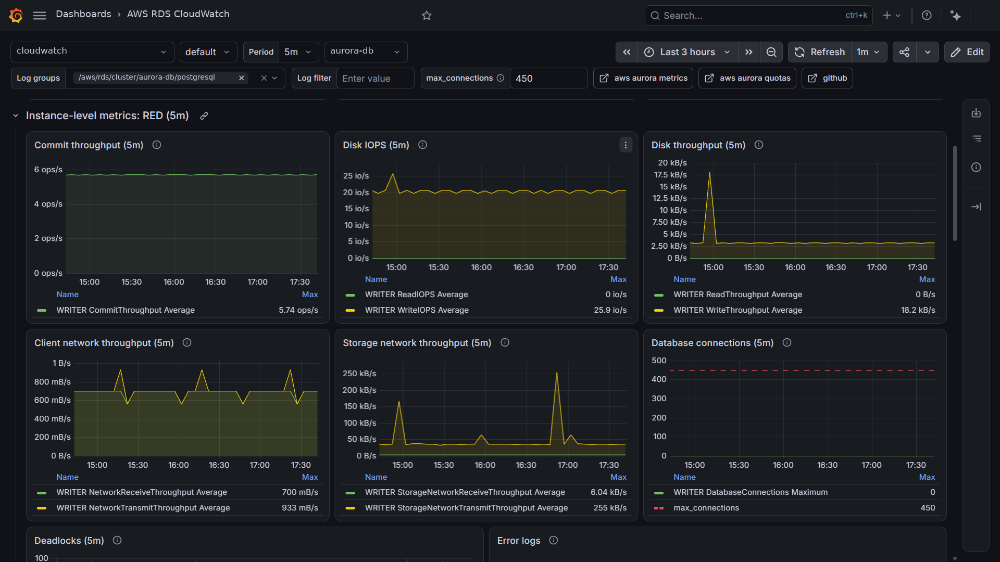
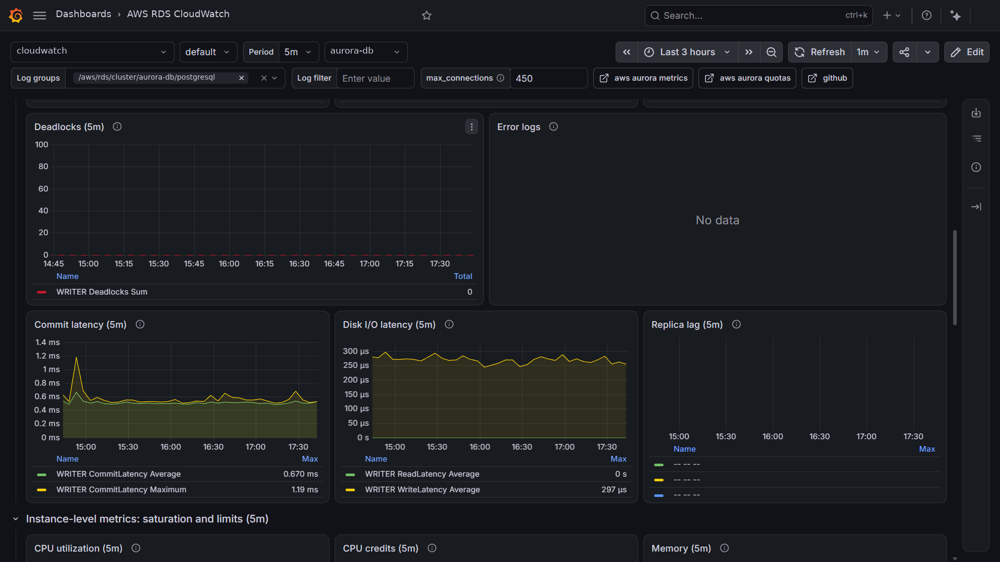
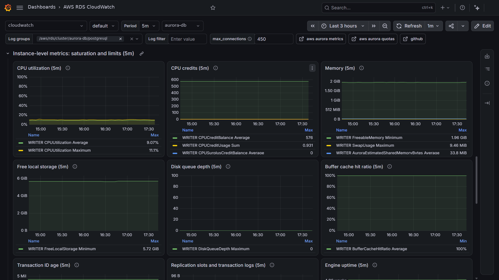
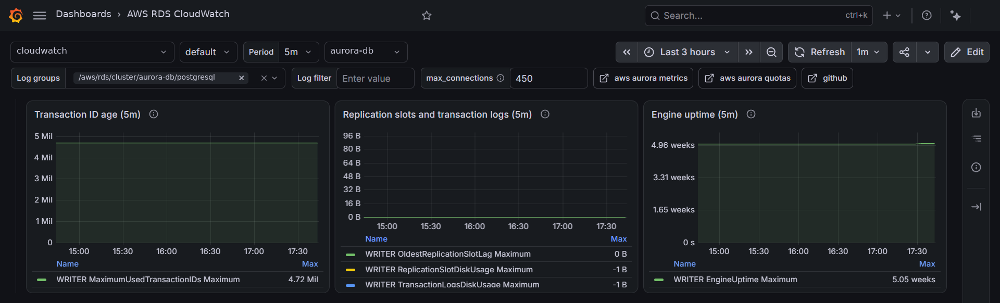

# AWS RDS Aurora

Dashboard: https://grafana.com/grafana/dashboards/25949

Reference: https://docs.aws.amazon.com/AmazonRDS/latest/AuroraUserGuide/Aurora.AuroraMySQL.Monitoring.Metrics.html

Quotas: https://docs.aws.amazon.com/AmazonRDS/latest/AuroraUserGuide/CHAP_Limits.html

This dashboard uses the AWS/RDS CloudWatch namespace for a provisioned Aurora PostgreSQL cluster with the [RED method](https://grafana.com/blog/2018/08/02/the-red-method-how-to-instrument-your-services/) (rate, errors, duration) followed by saturation and limits, plus the postgresql log export, the AWS/Usage account quotas, and two optional collapsed rows for Performance Insights and Enhanced Monitoring.

Rows follow the sections of the reference page. Metrics that apply only to Aurora MySQL, Aurora Serverless, Aurora Global Database, Optimized Reads, or ephemeral NVMe storage are left out.

## Deployed variant
Built for a cluster declared with the `aws-aurora-databases` Terraform module: `aurora-postgresql`, one burstable writer, provisioned, reader endpoint, `enabled_cloudwatch_logs_exports = ["postgresql"]`, IAM authentication. Performance Insights and Enhanced Monitoring are not set in the module call and the module defaults were not readable, so their rows stay collapsed until confirmed.

## Cluster-level metrics
Dimension `DBClusterIdentifier`. Volume storage against the cluster volume limit of the engine version, billed volume IOPs reported every 5 minutes, and backup storage billed inside and outside the retention window.

Size limits: https://docs.aws.amazon.com/AmazonRDS/latest/AuroraUserGuide/CHAP_Limits.html#RDS_Limits.FileSize.Aurora

## Instance-level metrics: RED
Dimensions `DBClusterIdentifier` and `Role`, one series per role (WRITER, READER). Aurora publishes every instance metric with this pair, so the panels stay on the selected cluster; a `DBInstanceIdentifier` wildcard would span every instance of the account.

- Rate: commit throughput, disk IOPS and throughput, client and storage network throughput, database connections against `max_connections`
- Errors: deadlocks, error logs including connection refusals
- Duration: commit latency, disk I/O latency, replica lag

`max_connections` is a text box variable drawn as a dashed line. Set it to the value of your parameter group; the default formula per instance class is on the AWS page below. Aurora emits no metric when it is hit; the refusal shows in the error logs as `FATAL: remaining connection slots are reserved`.

Reference: https://docs.aws.amazon.com/AmazonRDS/latest/AuroraUserGuide/AuroraPostgreSQL.Managing.html#AuroraPostgreSQL.Managing.MaxConnections

## Instance-level metrics: saturation and limits
Same dimensions. CPU with the credit balance of burstable classes, memory and swap, free local storage against the instance class limit, disk queue depth, buffer cache hit ratio, transaction ID age with the wraparound line, replication slots, engine uptime.

A credit balance flat at the cap of the instance class means the instance never bursts. Replication slot and transaction log metrics read a negative sentinel when logical replication is not in use.

Local storage per class: https://docs.aws.amazon.com/AmazonRDS/latest/AuroraUserGuide/AuroraPostgreSQL.Managing.html#AuroraPostgreSQL.Managing.TempStorage

CPU credits: https://docs.aws.amazon.com/AWSEC2/latest/UserGuide/burstable-credits-baseline-concepts.html

## Logs
The PostgreSQL log export of the selected cluster, log group `/aws/rds/cluster/<cluster>/postgresql`, with a substring filter. Charged as CloudWatch Logs ingestion.

Reference: https://docs.aws.amazon.com/AmazonRDS/latest/AuroraUserGuide/AuroraPostgreSQL.CloudWatch.Logs.html

## Usage metrics and quotas
Account-level RDS resource counts from the AWS/Usage namespace, and the percent of each applied quota used through the `SERVICE_QUOTA` metric math function, with a warning line. Creating a resource past its quota fails with an exception. Defaults and adjustability are on the quotas page; each panel description links the Service Quotas console entry.

| Quota | Console |
|---|---|
| DB clusters | https://console.aws.amazon.com/servicequotas/home/services/rds/quotas/L-952B80B8 |
| DB instances | https://console.aws.amazon.com/servicequotas/home/services/rds/quotas/L-7B6409FD |
| Manual DB cluster snapshots | https://console.aws.amazon.com/servicequotas/home/services/rds/quotas/L-9B510759 |
| DB subnet groups | https://console.aws.amazon.com/servicequotas/home/services/rds/quotas/L-48C6BF61 |
| Read replicas per primary | https://console.aws.amazon.com/servicequotas/home/services/rds/quotas/L-5BC124EF |

Reference: https://docs.aws.amazon.com/AmazonCloudWatch/latest/monitoring/CloudWatch-Usage-Metrics.html

## Performance Insights (optional)
Collapsed. `DBLoad`, `DBLoadCPU`, `DBLoadNonCPU`, and `DBLoadRelativeToNumVCPUs` are published only when Performance Insights is enabled and the instance has load. Database Insights standard mode has a free tier; longer retention and advanced mode are charged per vCPU-hour.

Reference: https://docs.aws.amazon.com/AmazonRDS/latest/AuroraUserGuide/USER_PerfInsights.Cloudwatch.html

Pricing: https://aws.amazon.com/cloudwatch/pricing/

## Enhanced Monitoring (optional)
Collapsed. OS CPU, memory, load average, and tasks parsed from the `RDSOSMetrics` log group with Logs Insights. Charged as CloudWatch Logs ingestion, proportional to the chosen granularity and to the number of instances.

Reference: https://docs.aws.amazon.com/AmazonRDS/latest/AuroraUserGuide/USER_Monitoring.OS.html
